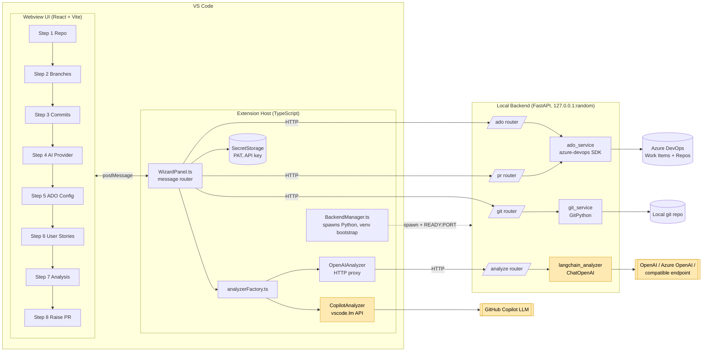

# 2. Solution Design

## 2.1 Architecture diagram



Yellow nodes are where AI is used.

If Mermaid does not render, here is the same picture in ASCII:

```
┌──────────────────────────── VS Code ─────────────────────────────┐
│  ┌───────────── Webview (React) ─────────────┐                   │
│  │ 1 Repo → 2 Branches → 3 Commits → 4 AI →  │                   │
│  │ 5 ADO → 6 Stories → 7 Analysis → 8 PR     │                   │
│  └──────────────────┬────────────────────────┘                   │
│                     │ postMessage                                │
│  ┌──────────────────▼──── Extension Host (TS) ──────────────┐    │
│  │ WizardPanel ── SecretStorage (PAT, API key)              │    │
│  │      │                                                   │    │
│  │      ├── analyzerFactory ─┬─ CopilotAnalyzer ──[AI]──────┼────┼──► GitHub Copilot (vscode.lm)
│  │      │                    └─ OpenAIAnalyzer ─┐           │    │
│  │      │ HTTP                                  │ HTTP      │    │
│  │ BackendManager (spawn, venv, READY:PORT)     │           │    │
│  └──────┼───────────────────────────────────────┼───────────┘    │
└─────────┼───────────────────────────────────────┼────────────────┘
          ▼                                       ▼
┌──────────── FastAPI backend (127.0.0.1:random) ─────────────┐
│ /git ── git_service (GitPython) ──────────► local repo      │
│ /ado ── ado_service (azure-devops SDK) ───► Azure DevOps    │
│ /pr  ── ado_service ──────────────────────► Azure DevOps    │
│ /analyze ── langchain_analyzer ──[AI]─────► OpenAI-compatible│
└─────────────────────────────────────────────────────────────┘
```

## 2.2 Main components

| Component | Tech | Responsibility | Key files |
|---|---|---|---|
| Webview UI | React 18, Vite | 8-step wizard, holds wizard state, shows results | [webview-ui/src/App.tsx](../webview-ui/src/App.tsx), [webview-ui/src/steps/](../webview-ui/src/steps/) |
| Extension host | TypeScript, VS Code API | Routes messages, stores secrets, runs the Copilot path, opens the created PR | [extension/src/WizardPanel.ts](../extension/src/WizardPanel.ts), [extension/src/extension.ts](../extension/src/extension.ts) |
| Backend manager | TypeScript, child_process | Creates the Python venv on first run, spawns the backend, finds its port | [extension/src/BackendManager.ts](../extension/src/BackendManager.ts) |
| Analyzer abstraction | TypeScript | `IAnalyzer` interface plus a factory, so the AI provider can be swapped | [extension/src/llm/](../extension/src/llm/) |
| Git service | Python, GitPython | Validates the repo, lists branches and commits, parses the ADO remote, builds the diff | [backend/services/git_service.py](../backend/services/git_service.py) |
| ADO service | Python, azure-devops SDK | Validates the PAT, lists projects, sprints and members, queries work items with WIQL, creates the PR | [backend/services/ado_service.py](../backend/services/ado_service.py), [backend/routers/pr.py](../backend/routers/pr.py) |
| LangChain analyzer | Python, langchain-openai | Story compliance analysis and PR content generation | [backend/services/langchain_analyzer.py](../backend/services/langchain_analyzer.py) |

## 2.3 Data flow

| Step | User action | Data path | Output |
|---|---|---|---|
| 1 | Pick repo folder | UI → Host → `POST /git/validate` → GitPython | Repo valid or not |
| 2 | Choose FROM/TO branches | `GET /git/branches` | Branch list |
| 3 | Select commits (or all) | `GET /git/commits?from&to` | Commit list (SHA, message, author) |
| 4 | Choose AI provider | Host SecretStorage (load/save key, base URL, model) | Provider config |
| 5 | Enter ADO org + PAT | `POST /ado/validate`; PAT saved to SecretStorage | Validated credentials |
| 6 | Pick project → sprint → stories | `GET /ado/projects`, `/ado/sprints`, `/ado/work-items` (WIQL) | Stories with title, description, acceptance criteria |
| 7 | Run analysis | `GET /git/diff` → **LLM call #1** (Copilot or `POST /analyze`) | `[{storyId, status, evidence, gaps}]` |
| 8 | Review and raise PR | **LLM call #2** (Copilot or `POST /analyze/pr-content`) → user edits → `POST /pr/create` | PR created in ADO; URL opened in browser |

## 2.4 Where AI is used

There are two LLM calls, and each can run on either provider.

| # | Purpose | Copilot path | OpenAI path | Input | Output |
|---|---|---|---|---|---|
| 1 | **Story compliance analysis** | [analyzeWithCopilot.ts](../extension/src/llm/analyzeWithCopilot.ts) | [langchain_analyzer.py `analyze_with_langchain`](../backend/services/langchain_analyzer.py#L26) | Stories (id, type, title, description, AC) + diff (≤ 30,000 chars) | JSON array of verdicts |
| 2 | **PR content generation** | [WizardPanel.ts `generate-pr-content`](../extension/src/WizardPanel.ts#L152) | [langchain_analyzer.py `generate_pr_content`](../backend/services/langchain_analyzer.py#L65) | Stories + verdicts/gaps + diff (≤ 25,000 chars) | JSON `{title, description, comment}` |

All other steps are ordinary code (GitPython, the ADO SDK, React). AI is used only where judgement or natural-language writing is needed.

## 2.5 Prompt design approach

### 2.5.1 Principles

1. **Role first.** Each prompt starts with a persona ("senior code reviewer", "senior software engineer writing a pull request for an Azure DevOps repository"). This sets the level of detail and the tone, and tells the model the output is for professional review.
2. **One task per prompt.** Analysis and PR writing are separate calls. A single "analyze and write the PR" prompt would mix a judgement task with a writing task, and the verdicts tend to get softer so they read well in the description. Keeping them apart gives sharper verdicts. The developer can also re-run analysis without regenerating the PR text.
3. **Fixed output contract.** Both prompts say *"Respond ONLY with valid JSON — no markdown, no explanation outside the JSON"* and spell out the exact schema, with enum values for `status`. The UI renders the fields directly, so free text would break it.
4. **Closed set of verdicts.** `PASS | PARTIAL | FAIL` instead of a score. Three states fit how developers think about a story (done / nearly / not), map to colours in the UI, and avoid false precision like "73% compliant".
5. **Evidence and gaps are required.** Every verdict needs `evidence` (a quote or reference from the diff) and `gaps` (what is missing, or an empty string). This makes the model ground its verdict in the code, and lets the developer check the verdict instead of trusting it blindly.
6. **Structured input with stable IDs.** Stories are sent as `[ID:1234] User Story: <title>` blocks with labelled `Description:` and `Acceptance Criteria:` lines, followed by the diff in a fenced `diff` block under Markdown headings. The model can tell where each part starts and ends, and the `storyId` in the answer can be matched back to the ADO item.
7. **Deterministic settings.** The OpenAI path uses `temperature=0`, so the same diff and stories give the same verdict on re-run.
8. **Context budget.** The diff is cut at 30,000 characters for analysis and 25,000 for PR content (the PR prompt also carries the analysis results). This keeps requests inside common context windows and keeps cost and latency predictable.
9. **Same prompts on both providers.** The Copilot and OpenAI paths use identical prompt text, so results are comparable whichever provider is selected.
10. **Tolerant parsing.** Models sometimes wrap JSON in ```` ```json ```` fences even when told not to. Both paths strip fences before `JSON.parse`. The Python analyzer also accepts `{ "results": [...] }`-style wrappers.

### 2.5.2 Prompt structure

```
SYSTEM:  <persona> + <task> + <JSON-only rule> + <exact schema>
USER:    ## User Stories
         [ID:<id>] <type>: <title>
         Description: <description | N/A>
         Acceptance Criteria: <AC | N/A>
         ...
         ## Git Diff
         ```diff
         <diff, truncated>
         ```
```

The full prompt text, with the reasoning behind each line, is in [05-summary-and-reflection.md §2](05-summary-and-reflection.md#2-prompts-used-and-why).

### 2.5.3 Provider note

The VS Code Language Model API has no `system` role. On the Copilot path the instruction block is sent as a `LanguageModelChatMessage.Assistant` message placed before the user message. In testing, Copilot followed it as a system instruction.

## 2.6 AI assistance in the design phase

> **Note to author:** replace or confirm these with what you actually did.

| Area | How AI helped |
|---|---|
| Architecture | *e.g. Asked Copilot Chat to compare "pure TS extension" vs "TS extension + Python backend"; picked the Python backend for the mature azure-devops SDK and LangChain* |
| Prompt wording | *e.g. Iterated the analysis prompt in Copilot Chat until it reliably returned bare JSON with the three status values* |
| Code scaffolding | *e.g. Copilot inline completions for the React step components and FastAPI routers* |
| Documentation | Claude Code generated this `docs/` folder from the finished codebase |
